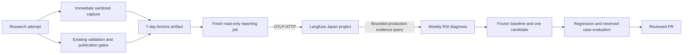

# Research observability and bounded RSI

The first Langfuse pilot covers **Generative Research**. Actions remains the
execution log; Langfuse stores a queryable, content-free observation tree and
mechanical outcome scores. Hooker continues operational notifications. This is
not yet fleet-wide tracing or an autonomous model-training loop.



## Configuration and entrypoints

Repository variable `LANGFUSE_BASE_URL` selects the region/instance. Repository
secrets `LANGFUSE_PUBLIC_KEY` and `LANGFUSE_SECRET_KEY` authenticate the project.
The initial project uses `https://jp.cloud.langfuse.com`; no keys belong in Git,
workflow inputs, prompts, artifacts, or an agent's environment.

- `.github/workflows/generative-research.yml`: snapshots each Claude-compatible
  attempt immediately, then uploads a sanitized bundle. A separate
  `langfuse-observability` job checks out `github.workflow_sha`, reads GitHub's
  measured job/step outcomes, re-projects the artifact, and exports it.
- `scripts/research_trace.py capture`: reads the action's JSON-array transcript
  (also accepts JSONL), emitting allowlisted observations without credentials.
  `summary` extracts only selected step outcomes and backend/publication flags.
- `scripts/langfuse_research.py export`: sends OTLP/HTTP JSON to
  `/api/public/otel/v1/traces` with `x-langfuse-ingestion-version: 4`, followed by
  a batch of boolean scores to `/api/public/scores`. It does not use deprecated
  trace ingestion. `--preview /absolute/path/trace.json` builds the same payload
  offline, without keys or a network call.
- `scripts/langfuse_research.py evidence --days 7 --output /tmp/evidence.json`:
  reads root observations through `/api/public/v2/observations`, production
  environment only, at most three pages / 300 runs. Outcomes, failed stages and attempt diagnostics are expanded
  to avoid the API's default truncation. A bounded window is not an exhaustive
  corpus; `truncated` reports pagination exhaustion.
- `.github/workflows/daily-improve.yml`: a separate fresh runner fetches evidence;
  the existing weekly agent receives only the resulting file under ignored
  `.rsi-input/`. Failure or missing credentials is explicitly `unavailable`.

Run the offline contract checks from the repository root:

```bash
uv run python -m unittest discover -s scripts -p 'test_research_observability.py' -v
actionlint -shellcheck= -pyflakes= .github/workflows/generative-research.yml .github/workflows/daily-improve.yml
```

The exporter expects the ordinary `GITHUB_REPOSITORY`, `GITHUB_RUN_ID`, and
`GITHUB_RUN_ATTEMPT` environment plus `RESEARCH_SOURCE_SHA`. `--jobs-file` is the
JSON response from GitHub's **attempt-specific** jobs API; `--bundle-dir` contains
the downloaded sanitized JSON files. Export commands return nonzero on failure;
workflow `continue-on-error` provides nonblocking behavior without hiding it.

## Observation contract and honest limits

One trace identifies repository + workflow run ID + run attempt. A Langfuse
session groups reruns of one GitHub run. Deterministic trace/span/score IDs and
stable score timestamps make replay address the same records; rerunning the
research workflow creates a separate attempt trace. The source SHA is propagated
to every observation alongside requested/effective backend and fallback status.

The root and known model/validation/publication stages use GitHub's wall-clock
times. Claude and Fireworks transcripts add ordered generation and tool markers:
observed registered model identifiers, reported token counts (including separate
cache categories), tool names, correlated success/error results, turns and
session-error state. Duplicate streaming messages with the same message ID are
one generation. Failed attempts remain visible even if a retry publishes.

The current transcript does **not** provide reliable per-event timing. Child
markers have zero duration at the attempt endpoint and `timing=not-reported`;
do not use them as model latency or tool-duration measurements. Session cost is
`runtime_estimated_cost_usd`, not a subscription invoice. Langfuse may infer list
price from model/token data; that also does not establish actual billed cost.

Cursor, OpenCode and Codex currently emit plain text in this workflow. Their
stage outcomes are recorded with `coverage=not-instrumented`; no model/tool
events, usage, or cost are fabricated. Their next increment requires validating
structured CLI output against existing error detection, canary assertions, and
container cleanup before changing those adapters. Other workflows are outside
this pilot.

Content policy is **metadata-only**: no prompts, chain of thought, assistant
prose, tool arguments/results, URLs from tool calls, exception bodies, or
credentials. Unknown tool names become `other`; unknown model IDs remain
`unknown`. Raw transcripts are capped at 32 MiB, captures at 2,000 events per
attempt, and imported files at 2 MiB. The reader rejects symlinks/nonregular
files; the reporter accepts only a fixed projection even if an agent modified
the upload. These are diagnostic claims, never trusted publication authority.

The boolean scores `research.quality`, `research.verifier-audit`, and
`research.methodology` reflect executed gates only. `research.published` exists
only when safe-push reported its publication flag. Missing/skipped gates have no
score, missing flags are null, and missing bundles still permit workflow-level
observations. A passing gate measures its mechanical contract; it is not a score
for insight, originality, coverage, or factual correctness.

All capture/export steps and the reporting job are nonblocking and bounded.
HTTPS, no redirects, at most one retry for rate limits/server/network faults,
and per-request timeouts constrain transport. A missing artifact or exporter
outage never changes the existing fail-closed research gates. Force cancellation
or runner death can prevent capture/reporting; absence must remain unknown.

## RSI contract

Traces identify candidate defects. They do not prove an improvement, reproduce
a time-varying web input, or authorize changing a model's weights. Before editing,
record the following in `docs/archive/YYYY-MM-DD-improvements.md`:

1. **One observed bottleneck:** cite trace/run IDs and an inspectable artifact.
2. **One treatment:** harness/prompt/tools, model/backend, or implementation code.
   Keep other dimensions fixed so the result is interpretable.
3. **Frozen comparison:** baseline revision, evaluator command/version and hash,
   input identities/hashes, primary acceptance threshold, regression limits,
   development/regression/reserved case IDs, and the full execution budget.
4. **Matched execution:** run baseline and candidate through the existing
   entrypoint on identical inputs/settings. Retain failures and retries, actual
   runtime model IDs/fallbacks, total wall time and observed usage. Unknown cost
   is not zero. Live source drift or unavailable replay inputs makes a comparison
   inconclusive.
5. **Promotion:** require measured improvement, no hard regression, and transfer
   to an independent reserved case. Never tune on the reserved answer, relax a
   validator, change reference answers, or promote from an LLM critic alone.
   An inspected failed holdout becomes development data for later experiments.

The existing weekly job permits one candidate and at most six case executions
within its 30-minute timeout. Use deterministic existing checks by default. New
paid model batches or publication-workflow dispatches are outside that budget;
record the experiment as proposed/inconclusive rather than changing routing
without matched evidence. For authorized Twitter model experiments, reuse
[`twitter-model-ab.md`](twitter-model-ab.md)'s frozen input, parity gate and
blinded evaluator instead of creating another runner.

Retain only verified candidates in a reviewed PR. Record per-case before/after
results, transfer/regressions, elapsed time, measured/unknown cost, decision, and
the next hypothesis. No completed baseline/candidate experiment or model-quality
gain is claimed by installing this observability layer.

API contracts were checked against Langfuse's
[OTLP integration](https://langfuse.com/integrations/native/opentelemetry) and
[public API](https://langfuse.com/docs/api-and-data-platform/features/public-api),
including the configured Japan instance's OpenAPI schema.
